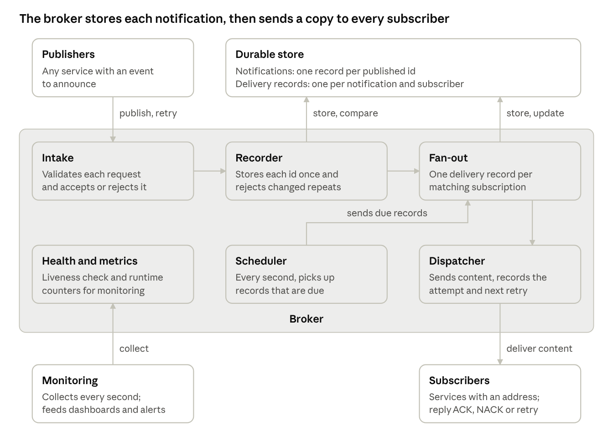
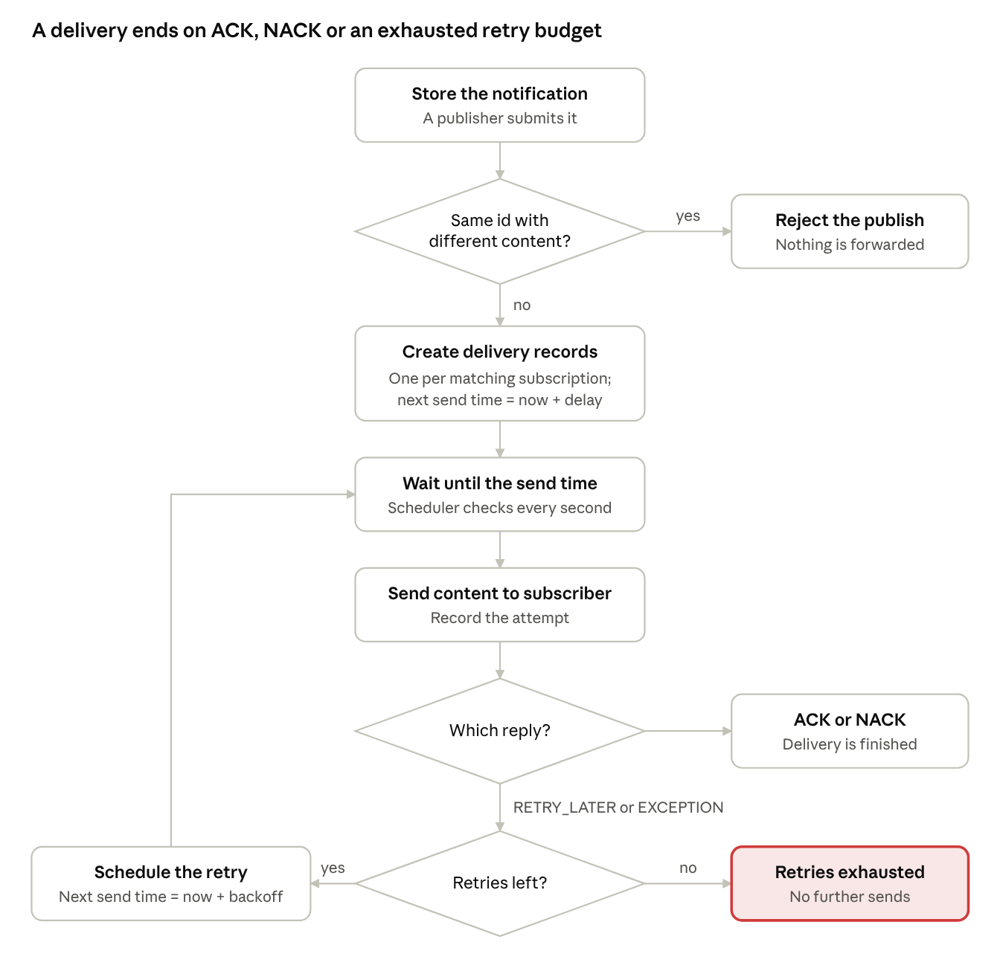

# Notifications System — Design Document

Last updated: 12 November 2026

## Overview

The system is a webhook fan-out broker: a publisher POSTs one notification, and the server stores it and forwards it over HTTP to every service subscribed to that notification type, retrying until each subscriber gives a final answer.

This document specifies the broker's behaviour so it can be ported to another technology stack or built into a larger system. It describes what the proof of concept was designed to do. Where the proof of concept left an operation unfinished, the intended behaviour is specified as if complete, and Assumptions in this document lists those places.

The design rests on five properties:

- **Durable accept.** A notification is written to durable storage before anything is forwarded.
- **Idempotent publish.** Re-sending the same id with the same body succeeds; the same id with a different body is rejected.
- **Publisher-chosen confirmation.** Each publish says how long the publisher will wait: not at all, until stored, until sent, or until subscribers reply.
- **Per-subscriber delivery state.** Each subscriber gets its own record, delay, retry budget and attempt history.
- **Subscriber-driven outcome.** The subscriber's reply (ACK, NACK, RETRY\_LATER) decides whether delivery ends or is retried.

| Term | Meaning |
| --- | --- |
| Publisher | A service that submits notifications |
| Subscriber | A service that receives them at an address |
| Notification | One published event: an id, a type, content and an initiator |
| Subscription | A standing rule: this subscriber wants this type, with this delay and retry policy |
| Delivery record | The state of one notification for one subscriber |
| Attempt | One try at delivering, with the reply it got |

Out of scope: the proof of concept's code layout, build and deployment, and its sample publisher and subscriber services.

## Architecture

One broker process does everything: it takes publishes over HTTP, keeps all state in a durable store, and calls subscribers over HTTP, while a scheduler in the same process drives delayed sends and retries.

Read it left to right along the top row for a publish, then down the right side for delivery. The scheduler re-enters the same send path every second for anything delayed or due a retry.

| Role | Responsibility |
| --- | --- |
| Intake | Exposes the publish, retry and late-update operations, validates each request, and answers a publish when its chosen confirmation level is reached |
| Recorder | Stores each notification once, applies the idempotency check and starts fan-out |
| Fan-out | Matches subscriptions by type, creates a delivery record per subscriber and sets each next send time |
| Dispatcher | Calls the subscriber and turns the reply or failure into a recorded attempt |
| Scheduler | Wakes every second and feeds due delivery records back into the send path |
| Subscription registry | Holds who wants which type, with each subscriber's delay, retry policy and address |
| Durable store | Keeps notifications and delivery records and enforces unique keys |
| Health and metrics | Reports liveness and runtime counters to the monitoring stack |

The broker holds no state in memory. Every decision is made from stored records, so it can restart at any point without losing a notification or a pending retry.

## Operations

The broker offers three operations that change state (publish, retry and late update) and three that only report (health, show configuration and metrics). Publish lets the publisher choose how much confirmation to wait for.

Each is a request carrying a structured message, answered with accept or reject, plus per-subscriber detail for a publish at levels 3 and 4. The proof of concept exposes them over HTTP; any request-reply transport will do.

| Operation | Caller | Purpose | Answer |
| --- | --- | --- | --- |
| Publish | Publisher | Submit a notification for delivery | Depends on the confirmation level the publisher chose, from an immediate acknowledgement to each subscriber's reply |
| Retry | Publisher or operator | Re-drive a stored notification | Accepted once its deliveries are re-sent or re-queued. Rejected if the id is unknown |
| Late update | Subscriber | Report the outcome of a delivery after the fact | Accepted once the outcome is recorded. Rejected if there is no such delivery |
| Health | Anyone | Liveness check | Succeeds while the broker is running |
| Show configuration | Operator | List the loaded subscriptions | The subscription list |
| Metrics | Monitoring | Runtime counters | The current counters |

### Publish

A publish carries one notification and the publisher's choice of confirmation level.

| Field | Meaning |
| --- | --- |
| Id | Publisher-chosen unique id. It is the idempotency key: the broker stores each id once |
| Type | One of a fixed set of notification types, and the only routing key |
| Content | Opaque payload. The broker never reads it and forwards it to subscribers unchanged |
| Initiator | Who caused the send. Copied onto every delivery attempt for audit |
| Confirmation level | How far the publish must get before the broker answers. One of the four levels below |

### Confirmation levels

The publisher picks one of four levels on each publish, trading speed against certainty.

| Level | The publisher wants to | Broker answers when | The answer tells the publisher |
| --- | --- | --- | --- |
| 1. None | Send, and not worry if it works | At once, before anything is stored | Only that the request arrived |
| 2. Stored | Know it was stored | The notification and its delivery records are stored | Accepted, or rejected as a conflicting id |
| 3. Sent | Know it went out to subscribers | Every due delivery has been sent to its subscriber | As level 2, plus for each subscriber: sent, could not be sent, or scheduled for later |
| 4. Replied | Know what subscribers said | Every due delivery has its first reply | As level 2, plus each subscriber's reply (ACK, NACK, RETRY\_LATER or EXCEPTION), or scheduled for later |

- **Same processing at every level.** The level changes only when the broker answers and what the answer holds. Storage, fan-out, delivery and retries are identical.
- **A property of the request.** The level is not stored with the notification and plays no part in the duplicate comparison, so the same notification can be re-sent at a different level.
- **Due deliveries only.** Levels 3 and 4 wait for deliveries that are due at publish time. A subscription with a delay is reported as scheduled and is not waited for.
- **First attempt only.** Level 4 waits for each subscriber's first reply. If that reply is RETRY\_LATER or EXCEPTION, the retries carry on in the background after the answer.
- **Bounded wait.** Levels 3 and 4 have a wait limit. When it passes, the broker answers with what it knows and reports the rest as pending. Delivery continues either way.
- **Level 1 is blind.** The publisher learns nothing about duplicates, conflicts or storage failures, so it suits callers that cannot wait and can tolerate a silent loss.

### Repeated publishes

- **Idempotent.** Publishing an id again with identical type, content and initiator is accepted and changes nothing. A publisher that gets no answer can safely re-send.
- **Conflicts rejected.** Publishing an existing id with any of those fields different is rejected at levels 2 to 4, and the stored notification is untouched.
- **No second delivery.** A repeat creates no new delivery records. At levels 3 and 4 the answer reports the existing deliveries as they stand, without waiting.

### Retry

| Field | Default | Meaning |
| --- | --- | --- |
| Notification id | required | Notification to re-drive |
| Initiator | required | Who asked for the retry |
| Inform new subscribers | no | Also create deliveries for subscriptions added since the original publish |
| Retry now | no | Send immediately instead of waiting for the next scheduler pass |

1. Look up the notification. If the id is unknown, reject.
2. Collect the notification's existing delivery records.
3. If inform new subscribers is set, create a delivery record for every current subscription of the notification's type whose subscriber has none yet.
4. For each record, if retry now is set, send it immediately and record the retry's initiator on the attempt in place of the original one. Otherwise set its next send time to now, so the scheduler sends it on its next pass.
5. Answer accepted when every step has succeeded.

### Late update

| Field | Meaning |
| --- | --- |
| Notification id | The notification the outcome is for |
| Outcome | ACK, NACK, RETRY\_LATER or EXCEPTION |
| Initiator | Who is reporting it |

A late update lets a subscriber that handles deliveries asynchronously report the real outcome when its work finishes. The broker records it as an attempt on that subscriber's delivery record and applies the same outcome rules as for a direct reply: ACK and NACK end the delivery, the other two schedule a retry.

## Routing and processing

Routing is by notification type only: every subscription for that type gets its own delivery record, and each record then moves through send, reply and retry on its own.

Each delivery record runs this loop on its own, so one subscriber never holds up another. A manual retry puts a record back at the wait step, or straight at the send step when retry now is set. A late update enters at the reply decision.

### Accept

1. Store the notification under its id. The store must refuse a second record with the same id.
2. If the id already exists, compare the stored copy with the new one. Identical: continue as if newly stored. Different: reject the publish.
3. Pass the notification and its receipt time to fan-out.

### Fan out

1. Select the subscriptions whose type equals the notification's type. If there are none, the notification is simply stored.
2. For each, create a delivery record keyed by notification and subscriber. It holds a copy of the notification, a copy of the subscription, an empty attempt history, and a next send time of receipt time plus the subscription's delay.
3. If a record with that key already exists, leave it alone. Re-publishing a notification therefore creates no second delivery and triggers no send.
4. Hand records that are already due (no delay) to the dispatcher at once. The confirmation level decides whether the publisher's answer waits for them. Records with a delay wait for the scheduler.

### Poll

The scheduler runs continuously with a one-second pause between passes. Each pass finds every delivery record whose next send time has passed and hands them to the dispatcher concurrently. This one loop serves delayed first sends, automatic retries, and records re-queued by the retry operation.

### Deliver one record

1. Send the notification's content to the subscriber's address.
2. Read the reply. No reply, a connection failure and an unreadable reply all count as an exception.
3. Record an attempt: unique id, reply type, timestamp, initiator, debug text.
4. Append the attempt to the record's history, mark it as the latest, compute the next send time, and save.

| Reply | Final? | What happens next |
| --- | --- | --- |
| ACK | Yes | Next send time is cleared; delivery is complete |
| NACK | Yes | Next send time is cleared; the subscriber refused it, no retry |
| RETRY\_LATER | No | Retried after the backoff wait |
| EXCEPTION | No | Retried after the backoff wait |

Retries stop once the attempts recorded before the current one reach the subscription's retry limit, so a record gets at most the limit plus one automatic sends. A record that runs out keeps its last non-final attempt and has no next send time.

### Backoff

The wait is added to the timestamp of the attempt just made. Here n is that attempt's number starting at 1, and f is the subscription's backoff factor.

| Strategy | Wait in ms | Waits after attempts 1, 2, 3 with f = 4 |
| --- | --- | --- |
| Linear | f | 4 ms, 4 ms, 4 ms |
| Geometric | 1000 × n × f | 4 s, 8 s, 12 s |
| Exponential | 1000 × n^f | 1 s, 16 s, 81 s |

Linear waits the factor itself, in milliseconds. The other two scale a one-second base. No jitter or ceiling is applied.

## Subscriber contract

The only delivery channel is an HTTP POST webhook: a subscriber is any service that exposes a URL and answers with the reply contract below.

### What a subscriber receives

- A request to the address in its subscription, with the notification's content as the body, unchanged.
- Nothing else. The content is the whole message, so anything a subscriber needs, such as a key for spotting a redelivery, must be inside what the publisher wrote.
- Delivery is at least once. The same content can arrive again after a RETRY\_LATER, an EXCEPTION or a manual retry, and a subscriber should handle that safely.

### What a subscriber replies

The reply is a small message holding a reply type and optional debug text.

| Reply type | Meaning |
| --- | --- |
| ACK | Received and handled. Stop |
| NACK | Refused. Stop, and do not retry |
| RETRY\_LATER | Not now. Try again after the backoff wait |
| EXCEPTION | Something failed. Treated like RETRY\_LATER; the broker also assigns it when the call itself fails |

Only the reply message counts; the transport's own status code is not inspected. The debug text is stored on the attempt, so the history shows why a delivery was refused or deferred.

A subscriber that cannot decide straight away replies RETRY\_LATER, or reports the real outcome afterwards with a late update.

### Delivery seam

The dispatcher reaches subscribers through one narrow operation: send this notification to this address and return the reply.

- The real implementation makes the network call described above.
- An in-memory implementation that records calls and returns scripted replies makes the whole delivery loop testable without a network.
- Further implementations can add other delivery channels without touching the rest of the broker.

## Data model and persistence

All state is two kinds of record, a notification as published and a delivery record per notification and subscriber; subscriptions are not stored and live only in configuration.

### Notification

| Field | Kind | Notes |
| --- | --- | --- |
| Id | Text | Unique key |
| Type | One of a fixed set | The routing key; the set of types is defined up front |
| Content | Text | Opaque payload |
| Initiator | Name | Who caused the publish |

### Delivery record

| Field | Kind | Notes |
| --- | --- | --- |
| Key | Notification id plus subscriber id | Unique; one record per notification and subscriber |
| Notification | Full copy | Lets a delivery be sent without a second lookup |
| Subscription | Full copy | A snapshot taken at fan-out, so later configuration changes do not affect records in flight |
| Next send time | Timestamp, optional | When the scheduler should next send it; empty means nothing further to do |
| Latest attempt | Attempt, optional | Empty until the first send |
| Attempt history | List of attempts | Every attempt in order, including the latest |

### Attempt

| Field | Kind | Notes |
| --- | --- | --- |
| Id | Text | Unique per attempt |
| Reply | ACK, NACK, RETRY\_LATER or EXCEPTION | The first two are final |
| Timestamp | Timestamp | When the reply or failure was recorded |
| Initiator | Name | Copied from the notification, or from a manual retry |
| Debug | Text, optional | The subscriber's debug text, or the broker's error text when the call fails |

### Subscription (configuration only)

| Field | Kind | Notes |
| --- | --- | --- |
| Id | Text |  |
| Subscriber | Id and display name |  |
| Type | Notification type | The routing key |
| Delay | Duration in ms | Wait before the first send |
| Retry policy | Retry limit, backoff strategy, backoff factor | Strategy is Linear, Geometric or Exponential |
| Address | URL | Where deliveries are sent |

### Delivery state

There is no status field. The state of a delivery is read from two fields together.

| State | Next send time | Latest attempt's reply |
| --- | --- | --- |
| Waiting for first send | set | none |
| Waiting for retry | set | RETRY\_LATER or EXCEPTION |
| Delivered | empty | ACK |
| Rejected | empty | NACK |
| Retries exhausted | empty | RETRY\_LATER or EXCEPTION |

### What the store must provide

- **Unique keys** on both record kinds. Idempotent publish and single fan-out both depend on the store refusing a duplicate.
- **Two lookups** beyond fetch by key: delivery records due before a given time, and delivery records for a given notification.
- **Durability.** Reads and writes wait for acknowledgement from a majority of the store's replicas.

## Configuration

The broker needs three settings: the subscription list, the scheduler interval and where its store lives.

| Setting | In the proof of concept | Notes |
| --- | --- | --- |
| Subscription list | A static list loaded at start-up | Each entry gives a subscriber, a type, a delay, a retry policy and an address, as in Data model and persistence |
| Scheduler interval | 1 second between passes | Sets how precisely delays and retry waits are honoured |
| Store | One durable store | Must meet What the store must provide |

The subscription list is read once. Each delivery record keeps its own copy of its subscription, so a change to the list affects only notifications published afterwards, and deliveries added by a retry with inform new subscribers set.

## Behaviour to verify after porting

A port is faithful when these checks pass. Each can be observed from outside the broker, through its operations, a stub subscriber and the stored records.

- [ ] Publishing a new notification is accepted, and one delivery record exists for each subscription of its type.
- [ ] Publishing the identical notification again is accepted and creates nothing new.
- [ ] Publishing an existing id with different content is rejected, and the stored notification is unchanged.
- [ ] A notification whose type has no subscriptions is accepted and stored, with no delivery records.
- [ ] A level 1 publish is answered before anything is stored, and is then delivered like any other.
- [ ] A level 2 publish is answered once the records are stored, without waiting for any subscriber.
- [ ] A level 3 publish is answered once every due delivery has been sent, and the answer lists each subscriber as sent, not sent or scheduled.
- [ ] A level 4 publish is answered once every due delivery has its first reply, and the answer carries those replies.
- [ ] At levels 3 and 4 a delayed subscription is reported as scheduled and does not hold up the answer.
- [ ] At levels 3 and 4 a subscriber slower than the wait limit is reported as pending, and its delivery still completes afterwards.
- [ ] Delivery, retries and stored records are the same whichever level was used.
- [ ] A subscription with no delay is delivered straight after the publish. One with a delay is delivered no earlier than the delay, and within one scheduler interval after it.
- [ ] The subscriber receives exactly the published content.
- [ ] ACK and NACK each end the delivery with one attempt recorded.
- [ ] RETRY\_LATER, EXCEPTION and an unreachable subscriber each schedule a retry at the backoff wait for the subscription's strategy.
- [ ] A delivery that never gets a final reply stops after the retry limit plus one sends.
- [ ] One subscriber failing or responding slowly does not delay delivery to another.
- [ ] Retry with retry now set re-sends at once and records the retry's initiator. Without it, the delivery goes out on the next scheduler pass.
- [ ] Retry with inform new subscribers set delivers to a subscription added after the original publish.
- [ ] A late update of ACK ends a delivery that was waiting for a retry.
- [ ] After the broker restarts, pending deliveries and retries carry on.

## Assumptions in this document

Four behaviours are specified from the proof of concept's message definitions and unfinished code, not from code that runs; confirm each before porting.

| Behaviour | Specified here as | Basis |
| --- | --- | --- |
| Confirmation levels | Four levels chosen on each publish, with a wait limit, delayed subscriptions reported as scheduled, and a per-subscriber answer at levels 3 and 4 | Level 1 is the proof of concept's fire-and-forget operation, level 2 its latest uncommitted publish path, and level 4 its last committed publish path. Level 3, the wait limit and the per-subscriber answer are new in this document. Reporting delayed subscriptions as scheduled is also new, and confirmed |
| Retry | Re-drives every delivery record of the notification, whatever its state; optionally adds records for new subscribers; sends now or re-queues | A commented-out sketch of this logic, plus the fields of the retry message |
| Late update | Records the reported outcome as an attempt and applies the normal outcome rules | Only the message definition exists. It has no subscriber field, so a port must add one or identify the subscriber from the caller |
| Subscriber debug text | Stored on the attempt | The reply and the attempt both have a debug field, which implies one feeds the other |

## Suggested enhancements

These go beyond what the proof of concept set out to do. The first four matter most once the broker runs inside a production system.

| Enhancement | What it adds |
| --- | --- |
| Delivery envelope and signature | Metadata sent with each delivery: notification id, type, attempt number and timestamp, plus a keyed signature of the body per subscription. Subscribers can then deduplicate and verify the sender |
| Multi-instance delivery | A due record is claimed in one atomic step that sets an owner and an expiry, so several brokers can share the work and each send happens once |
| Explicit status and dead-letter | A status on each delivery (pending, delivered, rejected, exhausted), and an alert or dead-letter list for exhausted deliveries |
| Time limits and transport status | A time limit per subscription; transport errors treated as failures; a subscriber's requested wait honoured for RETRY\_LATER |
| Status query | Look up a notification and see each subscriber's state and attempt history, so publishers can answer "did it arrive?" |
| Subscriptions as data | Store subscriptions alongside the other records, with operations to create, update, pause and delete them, so adding a subscriber needs no restart |
| Open types and filters | Notification type as a free-form or hierarchical topic with wildcards, plus an optional filter on fields inside the content |
| More channels | Further implementations behind the delivery seam: email, chat, mobile push, message queues. One notification could then reach people as well as services |
| Scheduled and batched delivery | A deliver-at time on the notification, quiet hours per subscription, and digests that fold several notifications into one send |
| Jitter and a ceiling on backoff | Randomised waits and a maximum wait, so many failed deliveries do not all retry at the same instant |
| Push instead of poll | The store notifies the broker of new records, and the poll remains only for delays and retries |
| Publisher authentication | A credential per publisher, with the initiator taken from the credential, not from the message |
| Subscriber protection | Per-subscriber concurrency limits and a circuit breaker, so one failing subscriber cannot exhaust the broker's connections |
| Delivery metrics | Counters and timers for accepted, sent, reply type, retries, backlog size and delivery latency per subscriber |
| Retention | Automatic removal of finished notifications and deliveries after a set period |
| Ordering | Optional in-order delivery per key for subscribers that need it |
